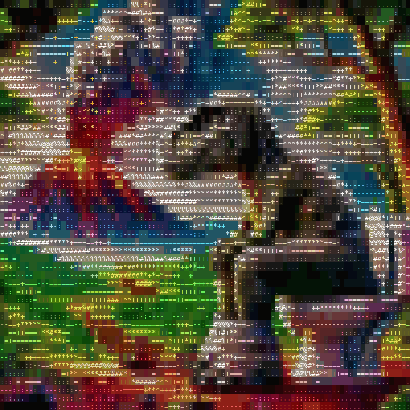

# trex-art

A T-rex on the toilet, as animated text art in your terminal. The lava flows, the embers fly and the smoke drifts.



## Run

```sh
python3 trex_art.py
```

On a Mac you can also double-click `trex.command` in Finder.

Press Ctrl-C to quit.

- Needs Python 3.8+ and nothing else; the image is built into the script.
- Works best in a terminal with truecolour (Ghostty, iTerm2, kitty, Windows Terminal, Terminal on macOS 26+). On older macOS Terminal it drops to 256 colours.
- Make the window bigger for more detail.
